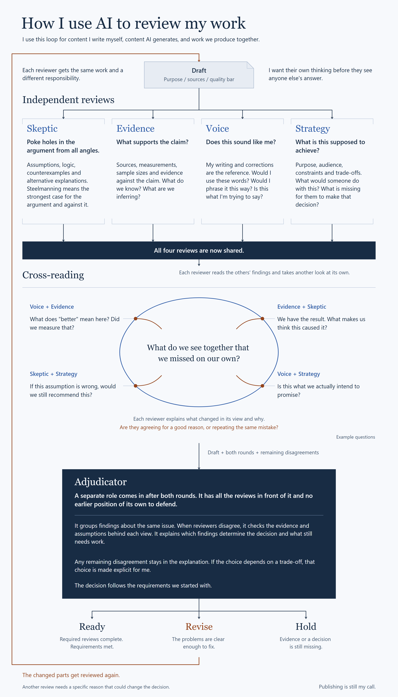

# Agent Council

[](https://github.com/Avyayalaya/agent-council/actions/workflows/test.yml)
[](LICENSE)
[](pyproject.toml)
[](CHANGELOG.md)

> *Four reviewers examine your work from distinct perspectives; a separate adjudicator turns their findings into a decision with reasons and required changes.*

A runtime-portable review gate for text you write, AI generates, or you create together. Skeptic, Evidence, Voice, and Strategy review independently, then read the full first-round findings for one second review. A separate Adjudicator synthesizes both rounds and remaining disagreements. Code enforces the final `SHIP`, `REVISE`, `HOLD`, or `INCOMPLETE` result; the model recommendation cannot bypass that policy.

No required SDK or API key in the core package. Runtime adapters use a configured CLI (`claude`, `ollama`), LM Studio's HTTP server, or an offline mock. Provider authentication and model availability are still your responsibility. Producing agents need no Council dependency.

*Personal research, separate from my day-job at Microsoft. MIT-licensed.*

[Install](#install) · [How it works](#how-it-works) · [Quickstart](#quickstart) · [Customize](#customize) · [AGENTS.md](AGENTS.md) · [CHANGELOG](CHANGELOG.md)

---

## Install

### Claude Code (plugin)

```bash
claude plugin marketplace add Avyayalaya/agent-council
claude plugin install agent-council@avyayalaya
```

Then in any Claude Code session: `/council-review path/to/artifact.md` or `/council-sweep`.

### Python (pip from source)

```bash
git clone https://github.com/Avyayalaya/agent-council.git
cd agent-council
pip install -e .
cp council.yaml.example council.yaml  # then edit
python -m agent_council review path/to/artifact.md --tier=1 --config=council.yaml
```

Requires Python ≥3.11 and a configured runtime. `mock_cli` needs no model or external service.

### MCP server (Claude Desktop, Cursor, Cline, custom agents)

```bash
pip install "mcp>=1.0"
```

Add to your client's MCP config:

```json
{
  "mcpServers": {
    "agent-council": {
      "command": "python",
      "args": ["<absolute-path>/agent-council/mcp/agent_council_mcp_server.py"],
      "env": {
        "COUNCIL_CONFIG": "<absolute-path>/agent-council/council.yaml"
      }
    }
  }
}
```

Tool exposed: `council_review(artifact_path, tier=1)`. Full setup: [mcp/README.md](mcp/README.md). Use the Python CLI for sweep and audit.

### GitHub Copilot CLI, Cursor, Cline, OpenCode (via APM Skills)

`v0.1.1` ships each deliberator as a standalone Skill under [`skills/`](skills/) so any APM-compatible harness gets the methodology inline — no Python CLI required for single-perspective review.

```bash
apm marketplace add Avyayalaya/agent-council
apm install agent-council --target copilot
```

Then in the harness, load one Skill at a time:

- [`skeptic-review`](skills/skeptic-review/) — adversarial steelman pass
- [`voice-identity-review`](skills/voice-identity-review/) — line-level voice audit + CXO test
- [`evidence-calibration-review`](skills/evidence-calibration-review/) — per-claim T1-T6 evidence-tier audit
- [`strategy-stakes-review`](skills/strategy-stakes-review/) — goal-fit and opportunity-cost check
- [`adjudicator-synthesis`](skills/adjudicator-synthesis/) — verdict synthesis from 2+ deliberator outputs

Use cases per surface:

| Use case | Surface |
|---|---|
| Run full automated Council on an artifact with parallel deliberators + 2-round cross-read + JSONL audit | `python -m agent_council review path/to/artifact.md --tier=1 --config=council.yaml` or MCP `council_review` tool |
| Apply one deliberator role to a doc I am editing right now (Copilot, Claude, Cursor) | Load the matching Skill |
| Compose 2 or 3 deliberators ad-hoc for a multi-angle ad-hoc review | Load multiple Skills sequentially, then optionally load `adjudicator-synthesis` |
| Use slash commands in Claude Code | `/council-review path/to/artifact.md` (Claude Code only) |

### Skills vs CLI — what you get on each path

The Skills are the **interactive** role-specific surface. The CLI / MCP is the **automated** full-Council surface with four reviewers and separate synthesis. Standalone Skills do not enforce the runtime's configured policy:

| Capability | Compose Skills sequentially | Full Council via CLI / MCP |
|---|:---:|:---:|
| One perspective at a time | yes | yes (the deliberators) |
| Parallel deliberator execution | no | yes |
| Round 2 cross-read (each reviewer sees all four R1 findings, including its own) | no | yes |
| Adjudicator prior-verdict compounding loop on `artifact_type` | no | yes |
| JSONL audit log and archived transcripts | no | yes |
| Single synthesized decision | optional synthesis Skill | yes, with enforced policy |
| Structured, persisted verdict record per run | no | yes |
| Calls per review | harness-dependent | 9 on the default happy path; at most one schema reprompt per call |
| Sweet spot | Ad-hoc 1 or 2 perspectives on a doc you are editing | Pre-ship gating in pipelines; structured, persisted audit trail |

Sequentially composing review Skills can provide multiple perspectives and optional synthesis. It does not ensure independent first reads, run the two-round protocol, or enforce the Python verdict policy. Use the CLI / MCP path for those guarantees and persisted records.

### Any other LLM (ChatGPT, Gemini, manual)

Read the four reviewer prompts and the separate synthesis prompt at [`prompts/`](prompts/). For manual review, keep first reads separate and supply the actual policy to the adjudicator. The automated rules live in [`VerdictPolicy`](src/agent_council/verdict.py) and [`merge_verdicts`](src/agent_council/orchestrator.py).

---

## How it works

1. **Independent first reviews:** four parallel calls receive the artifact and their role-specific context, without seeing each other's answers.
2. **One cross-read round:** each receives the full available R1 payloads, not just scores. Different perspectives can expose new questions: does "better" have a measurement, or does the evidence support a causal interpretation? Reviewers record concessions, escalations and reasons; agreement is not the objective.
3. **Separate synthesis and enforcement:** the Adjudicator reads both rounds and up to five prior verdicts of the same artifact type. It recommends a decision, explains disagreements and proposes changes. Code applies the configured policy and merges its result with that recommendation.

The default is two review rounds plus one synthesis, not a continuous debate or automatic revision loop. `rounds: 1` disables R2. A later review is a new invocation chosen by the operator.

| Default policy | Result |
|---|---|
| Fewer than three schema-valid R1 reviews, or unusable synthesis | `INCOMPLETE` |
| Any participating valid-R2 irreducible flag, or at least three hard/soft blocks | Policy `HOLD` |
| No hard/soft blocks and every present score is at least 3 | Policy `SHIP` |
| Remaining cases, including a score of 2 or one/two blocks | Policy `REVISE` |

`would_block` is a hard block; a score at or below 1 counts as a soft block when that reviewer has no hard block. Valid R2 takes precedence; failed or disabled R2 falls back to valid R1. Failed R1 never counts toward quorum, even if R2 succeeds. The stricter of model recommendation and policy wins, except policy `HOLD` may become `REVISE` when the model recommends it and there is no participating irreducible dissent.

Schema failure triggers one reprompt; there are no additional runtime-error retries. Synthesis timeouts/runtime failures return audited `INCOMPLETE`. Review failures and R1 fallback are visible in the returned record and dissent summary. Missing actionable briefs are explicitly reported with available reviewer findings rather than invented fixes. See [architecture](docs/architecture.md) for the output and failure contract.

### My review workflow



The author's workflow for authored, AI-generated and co-created content. The diagram's "required reviews complete" standard and revise/review loop describe the personal workflow, not an exact executable state machine. This implementation retains a three-valid-R1 quorum and valid-R1 fallback when R2 fails; it does not require all four reviews in both rounds. Publishing remains the operator's decision.

[Read the accompanying LinkedIn post](https://www.linkedin.com/posts/parthsangani_a-lazy-mans-guide-to-improving-your-writing-share-7523597492043608064-AyIS/).

### The five roles

| Role | Concern | Reads |
|---|---|---|
| **Skeptic** | Adversarial review — catches premature coherence, narrative fallacy, survivorship bias, unstated assumptions | (artifact only) |
| **Voice & Identity** | Voice DNA, banned-pattern enforcement, channel register, CXO test | Operator's voice corpus + persona DNA |
| **Evidence & Calibration** | Assess supplied support, evidence tiers (T1–T6), confidence and base rates; identify gaps | Artifact + optional supplied source/context text |
| **Strategy & Stakes** | Goal alignment, stake calibration, opportunity cost vs. operator's active projects | Operator's goals doc + project state |
| **Adjudicator** | Separate synthesis, recommendation and revision brief; runtime enforces final verdict | Both review rounds + prior verdict summaries |

### Why a council, not a single judge?

A review needs to answer distinct questions:

- Is the argument adversarially sound?
- Does it match the operator's voice?
- Are the sources credible?
- Does it advance the operator's actual goals?
- Should it ship?

A single judge can address multiple criteria too. Council makes the division of responsibility explicit and preserves who raised an issue, what changed after cross-reading, and what remains disputed. More reviewers or cross-reading do not establish better output: comparative quality is a hypothesis, not a demonstrated result in this repository.

This matters for tier-1 artifacts where the cost of shipping a flaw is high (public publish, irreversible commitment, identity-shaping document) and the cost of one more revision pass is low.

---

## Quickstart

After `pip install -e .` and copying `council.yaml.example` → `council.yaml`:

```bash
# Single artifact
python -m agent_council review path/to/artifact.md --tier=1 --config=council.yaml --json

# Daily sweep over watch paths
python -m agent_council sweep --since=24h --config=council.yaml

# Audit recent verdicts
python -m agent_council audit --since=7d --log=council_log.jsonl
```

Review output is human-readable unless `--json` is supplied. Each completed protocol run, including structured failures, appends an audit row to the configured log. For an offline smoke review, use `--config=tests/council.example.yaml` with `tests/sample_artifact.md`; the shipped mock fixture returns `REVISE` (exit 1).

### See what a verdict looks like

[`examples/demo/`](examples/demo/) ships a fictional LinkedIn post + the structured verdict the Council produced for it + the extracted revision brief. Read these first to calibrate expectations before running your first real review.

### Tier classification

The Council is designed for **tier-1 artifacts** — the ones where review cost is justified:

- **Tier 1** (gates through Council): external-facing OR irreversible OR identity-shaping OR memory writes. Examples: published writing, public READMEs, investor messages, resume revisions, additions to a learnings file, memory writes.
- **Tier 2** (skips Council): internal drafts, dashboards, infrastructure, dispatch updates.
- **Tier 3** (1-in-5 sample): daily briefings, internal analyses, planning artifacts.

Tier classification is rule-based — glob patterns in `council.yaml#tier_rules`. The sweep applies skipping/sampling. An explicit `review` or `Council.run()` still reviews the requested artifact; its tier is metadata, not an automatic skip.

---

## Built for agents

The Council was designed to be invoked from outside an agent loop, not from inside it. That's not a stylistic choice — it's a **CI-tested invariant**:

```bash
PYTHONPATH=src python -m unittest tests.test_modularity_invariant -v
```

The test scans the host operator system's `agents/*/prompt.md` files and asserts zero references to Council. If a producing agent's prompt starts to know about the gate that reviews it, the build fails.

This means:

- An orchestrator can route any artifact to Council without touching the producing agent.
- Removing the Council leaves every producing agent functional; its effect on quality is not established by the modularity test.
- The Council ships as a **standalone runtime** — wire it into Emissary, MCP servers, slash commands, CI pipelines, or your own agent system without coupling.

[`AGENTS.md`](AGENTS.md) is the machine-readable capability manifest — agent orchestrators read this to route tasks without reading 1,300 lines of source.

---

## Customize

### Use a caller-supplied runtime

```python
from pathlib import Path
from agent_council.config import load_config
from agent_council.orchestrator import Council
from agent_council.runtimes.base import RuntimeAdapter
from agent_council.verdict import Verdict

async def review_with(runtime: RuntimeAdapter, artifact: Path) -> Verdict:
    config_path = Path("council.yaml").resolve()
    council = Council(
        load_config(config_path), config_path.parent, adapter=runtime
    )
    return await council.run(artifact, tier=1)
```

The keyword-only `adapter` skips configured runtime construction. Omitting it (or passing `None`) preserves the standalone default. All rounds, schema checks, policy and audit logging stay the same; the supplied adapter owns timeout handling and its identity is recorded in the log.

### Add a configured runtime adapter

Implement the existing [`RuntimeAdapter`](src/agent_council/runtimes/base.py) interface: `async invoke(prompt, context, model=None) -> str`, `health_check() -> bool`, and `adapter_name() -> str`. `invoke` must complete within the adapter timeout or raise `asyncio.TimeoutError`; runtime failures raise `RuntimeError`. To select it through YAML/CLI, register it in `src/agent_council/runtimes/__init__.py`. A caller-supplied adapter needs no registry change.

### Add a new deliberator

Drop a `prompts/<name>.md` following the 5-section template:

1. **Role declaration** — who you are, what you optimize for, what you do NOT do.
2. **Methodology** — numbered steps for reading the artifact and producing the critique.
3. **Context Verification Gate** — files this deliberator must have access to.
4. **Output schema** — matching the JSON shape in [`src/agent_council/schema.py`](src/agent_council/schema.py).
5. **Communication style** — 3–5 example phrases showing the deliberator's editorial voice.

Register the new role/rounds in `src/agent_council/schema.py` and add a block to `council.yaml#deliberators`. A prompt/config entry alone is insufficient: unregistered roles fail schema validation. Review the quorum and policy assumptions when changing the panel.

### Override the verdict policy

Tune `ship_min_score`, `soft_block_score`, and `hold_block_count` in `adjudicator.verdict_policy`. `VerdictPolicy.apply` computes the policy result and `orchestrator.merge_verdicts` enforces the model/policy merge. There is no constructor policy-injection parameter. Tests pin the default semantics; changing the merge rule is a separate code change.

---

## Audit log

Completed protocol runs append one line to the configured `council_log.jsonl`, including quorum and synthesis failures. Setup, programming and log-write errors may raise instead. The record is flat; this is an abridged shape (the real `deliberators` object contains the per-role records):

```json
{
  "v": 2,
  "span_id": "council-0123456789ab",
  "artifact_path": "path/to/artifact.md",
  "artifact_type": "linkedin_post",
  "verdict": "REVISE",
  "deliberators": {},
  "adjudicator_reasoning": "Enforced decision and reasons.",
  "revision_brief": "1. Required change.",
  "dissent_summary": "Remaining disagreement or review failures.",
  "adjudicator_error": null,
  "adjudicator_schema_failed": false,
  "adjudicator_reprompts": 0,
  "prior_verdicts_used": 3,
  "persisted": true
}
```

Raw attempts, retries and the artifact snapshot live under the configured archive directory, keyed by `span_id`. Per-role records include `succeeded` (valid R1), `error` (R1 failure), `r2_error`, and round schema-failure flags. `adjudicator_error` describes failed synthesis. Prior-verdict lookup supplies up to five same-type summaries to the Adjudicator only; this is context reuse, not proven learning or automatic quality improvement.

Filter with `jq` or the `audit` subcommand:

```bash
jq 'select(.verdict == "HOLD")' council_log.jsonl
python -m agent_council audit --since=7d --log=council_log.jsonl
```

---

## Runtimes

| Runtime | Recommended for | Notes |
|---|---|---|
| `claude_cli` | Production tier-1 gating | Requires Anthropic Claude CLI installed + authenticated. Default. |
| `lmstudio` | Local sub-sample testing | HTTP 500 on large parallel prompts at default concurrency — tune `max_concurrent` and `context_length`. |
| `ollama` | Offline / local-first | Lower-end models may not satisfy the deliberator schema; fall back to `claude_cli` for production. |
| `mock_cli` | CI / smoke tests | Canned responses for testing the orchestrator without burning tokens. |
| `gh_models` | Stub (documented fallback) | Placeholder for future GitHub Models adapter. |

One adapter is used for all reviewers and synthesis. Per-deliberator `runtime_override` is not implemented; mixed-model panels are future work, not a current configuration option.

---

## Honest limitations

- **Soft file-path coupling.** Voice & Identity and Strategy & Stakes read external context files. What they contain is the operator's responsibility.
- **Same-model blind spots.** Separate first reviews protect distinct starting perspectives, not statistical independence. Reviewers can share errors and cross-reading can reinforce them. Mixed-model panels are not built in.
- **Evidence is bounded by supplied material.** Council does not retrieve cited URLs or perform source-finding. Supply relevant source text through `context_refs`; a citation alone does not mean its content was verified. Any tools available inside a provider runtime are outside this package's guarantees.
- **Permissive completeness.** Three valid R1 reviews can suffice and valid R1 can replace failed R2. `SHIP` does not mean all four reviews completed both rounds.
- **Evaluation remains open.** Mock tests establish protocol behavior, not superior judgments. Benchmark scaffolding exists, but no published comparative results establish a quality lift; the evaluation is planned in the [CHANGELOG](CHANGELOG.md).
- **Behavioral coupling on producing agents.** If a producing agent learns "the Council will catch X," it may loosen on X. Structural and unfixable inside the package; mitigation is operator discipline (periodic audits with Council OFF vs. ON).
- **Adjudicator non-determinism.** Same artifact can produce slightly different verdicts across runs. Documented; treated as honest LLM-as-judge variance.

---

## Tests

```bash
PYTHONPATH=src python -m unittest discover tests -v
```

The orchestrator tests use mock/scripted adapters, so no real model calls are needed. When validating a checkout, set `PYTHONPATH` to its `src` directory to avoid an installed copy. In PowerShell: `$env:PYTHONPATH = (Resolve-Path .\src).Path`, then `python -m unittest discover tests -v`.

---

## License

MIT. See [LICENSE](LICENSE).

---

## Citation

```
Agent Council: A runtime-portable adjudicator council for tier-1 artifact gating.
v0.1.0, 2026. https://github.com/Avyayalaya/agent-council
```
